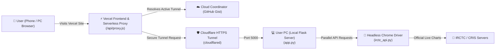

# 🚂 IRCTC Green Seat Finder & Split Journey Planner

A smart, high-performance railway seat finder and split-journey itinerary planner for Indian Railways. It connects directly with IRCTC/CRIS live charts to identify vacant berths, hop seats across intermediate stations, and maximize your chances of getting confirmed tickets—even on fully booked trains.

---

## 🌟 Key Features

* **⚡ Ultra-Fast Search Engine (< 1s)**: Leverages browser-level parallel batching (`Promise.all`) inside headless Chromium to query all coach classes (`1A`, `2A`, `3A`, `3E`, `SL`, `2S`) concurrently.
* **🧠 Smart Split-Journey Hopper**:
  * **Direct Seats First**: Prioritizes 100% direct route seats.
  * **Same-Coach Luggage Preference**: Finds split itineraries within the same coach so passengers don't have to carry luggage across coaches during the journey.
  * **Multi-Passenger Clustering**: Keeps groups and families in adjacent or same-compartment berths whenever possible.
* **📱 100% Mobile & Client-Ready**: Fully responsive design tailored for smartphones (touch-friendly targets, horizontal berth matrix scrolling, and iOS Safari viewport auto-zoom prevention). Zero developer debug badges or connection modals.
* **🔄 Zero-Configuration Cloud Coordinator**: When deployed on Vercel, the site automatically detects your PC backend using a cloud coordinator. No manual copying or pasting of Cloudflare tunnel URLs is required.
* **🔔 Live Real-Time TTE Vacancy Monitoring**: Audio/visual alerts and background polling to notify you the instant newly allotted or vacated seats appear on the chart.
* **💾 Multi-Tier In-Memory Caching**: Station schedules and train coach compositions are cached in memory for instantaneous repeat lookups.

---

## 🏗️ Architecture

---

## 🚀 Quick Start Guide

The repository includes dedicated 1-click batch scripts for Windows:

### 1. Run 100% Locally on Your PC
To use the tool entirely offline on your computer:
1. Double-click **`Run_Local_Website.bat`**.
2. Dependencies are automatically verified and installed.
3. The server starts on port `5000` and automatically launches `http://localhost:5000` in your default browser.

---

### 2. Host as the Live Backend for Vercel
To let friends, clients, or mobile devices access your Vercel-hosted website using your PC as the live scraper:
1. Double-click **`Host_Backend_For_Vercel.bat`**.
2. The launcher will:
   * Launch a secure Cloudflare Tunnel to your local port 5000.
   * Automatically update the cloud coordinator with your live tunnel URL.
   * Start the Flask backend.
3. Your Vercel website (e.g. `https://irctc-seat-checker.vercel.app`) is **instantly connected** to your PC with zero manual steps!

---

### 3. Deploy Updates to GitHub & Vercel
To commit and deploy local modifications to GitHub and trigger automatic Vercel deployment:
1. Double-click **`GitHub_Quick_Push.bat`**.
2. The utility automatically detects your existing repository.
3. Press **`ENTER`** (Choice `[1]`). All changes will be staged, committed, and pushed to `origin main` automatically.

---

## 📡 REST API Reference

All API calls are exposed under `/api/*`:

| Endpoint | Method | Description |
| :--- | :---: | :--- |
| `/api/train-info/<train_no>?date=<YYYY-MM-DD>` | `GET` | Fetches train route stations, arrival/departure schedule, and available classes. |
| `/api/find-seats` | `POST` | Initiates an asynchronous background seat search. Returns a unique `searchId`. |
| `/api/search-status/<search_id>` | `GET` | Polls the progress and returns computed split-journey options and vacant seats. |
| `/api/live-poll` | `POST` | Real-time monitoring endpoint to detect newly allotted seats or fresh vacancies. |
| `/health` | `GET` | Health check endpoint returning backend status and timestamp. |

---

## ⚠️ Important Operating Notes

> [!NOTE]
> **IRCTC Daily Maintenance Downtime (23:45 to 00:20 hrs IST)**:
> Indian Railways (CRIS/IRCTC) shuts down all national charts, booking, and enquiry APIs daily between **23:45 and 00:20 hrs IST** for system maintenance. During this window, IRCTC queries return a maintenance downtime status. Normal operations resume automatically at 00:20 hrs.

> [!TIP]
> **Chart Preparation Timing**:
> First charts are typically prepared by Indian Railways **4 hours before departure** of the train from the originating station. Second/final charts are prepared 30 minutes before departure.

---

## 💻 Tech Stack & Requirements

* **Operating System**: Windows 10/11, macOS, or Linux
* **Python**: 3.10 or higher
* **Browser**: Google Chrome installed (managed headlessly by Selenium)
* **Frontend**: HTML5, Vanilla JavaScript (ES6+), CSS3 Flexbox/Grid
* **Hosting**: Vercel (Frontend & Serverless Proxy), Cloudflare Tunnel (Secure ingress)
